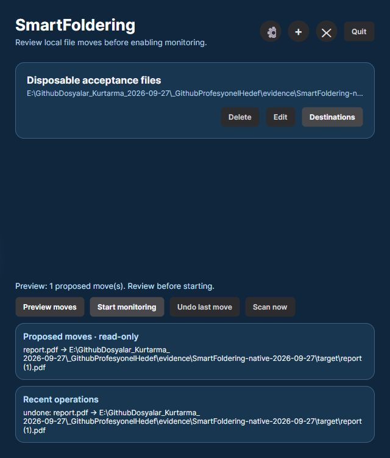

# SmartFoldering

**See every proposed file move before it happens.** SmartFoldering is a Windows desktop app built with C#, .NET 10 and Avalonia. Define extension or filename rules, review the destination for each top-level file, then start monitoring. Pause and undo the last move when the original path is free and the moved bytes still match.



*Real Windows capture from 27 September 2026 with disposable test files. The current build adds light/dark themes and larger text; this capture uses the earlier layout and shows the test directory.*

The **0.3.0-preview.2** Windows package passed 40 tests and selected native preview, move, pause, undo, appearance and restart checks. It is a local candidate, with no published installer or clean-machine acceptance yet. See [runtime results](docs/RUNTIME.md), [appearance checks](docs/APPEARANCE.md) and the [workflow diagram](docs/workflow.svg).

The native check used disposable local files. The normal profile's settings and Windows startup entry stayed unchanged. File hashes and the durable `intent → moved → undone` journal were checked after each cycle. **Quit** stops the worker and closes the app; **Hide window** keeps it available in the tray.

Choose **Settings → Theme / Text size**, then Save. Opaque surfaces, wrapping actions, scrollable/resizable windows and explicit keyboard focus support larger text. Appearance-only Save keeps monitoring and preview approval unchanged, and leaves Windows startup untouched unless its checkbox was changed. This uses text fonts, not Windows DPI or native blur. See [appearance, contrast calculation and native acceptance steps](docs/APPEARANCE.md).

## Quick start on Windows

Install a stable .NET 10 SDK and run from the repository root. `global.json` selects a .NET 10 feature band and excludes preview SDKs:

```powershell
dotnet run --project SmartFoldering.csproj
```

1. Add a source folder, such as a **test** `Downloads` folder. Add a destination folder and an extension rule such as `.pdf`.
2. Choose **Preview moves**. The proposed source and destination paths are displayed without moving a file.
3. Review the list, then choose **Start monitoring**. If rules change, monitoring pauses and another preview is required.
4. Choose **Pause monitoring** before **Undo last move**. Undo refuses to overwrite an existing source or move a destination whose SHA-256 differs from the recorded file.

If preview reports that a destination is the same as, inside, or above its source, edit the destination to a separate folder and run Preview again. Monitoring remains off; a failed preview cannot authorize a Start.

For a separate disposable or portable profile, launch with `--data-directory` and an absolute folder path. Settings, the move journal and logs stay in that directory; different profiles use separate instance locks. Windows sign-in startup is disabled for these profiles, so saving their Settings window cannot change the normal profile's registry entry. No existing settings are copied automatically.

```powershell
dotnet run --project SmartFoldering.csproj -- --data-directory E:\SmartFoldering-TestProfile
```

For source development: `dotnet test SmartFoldering.Tests/SmartFoldering.Tests.csproj -c Release`. There is no published installer for this revision. Start with disposable test files; the local native check does not prove every user's filesystem or permissions.

The three Windows integration tests require an explicitly selected disposable root via `SMARTFOLDERING_WINDOWS_TEST_ROOT`; otherwise they are skipped. See [actual kernel/permission checks and reproduction](docs/WINDOWS_INTEGRATION.md) for the command, owned-fixture cleanup and evidence limits.

## Example preview

With `C:\Test\Downloads\report.pdf` and rule `.pdf → C:\Test\Documents`:

```text
Preview: 1 proposed move
report.pdf → C:\Test\Documents\report.pdf
```

If `report.pdf` already exists at the destination, the plan proposes `report (1).pdf`. At execution, a new conflict or changed source causes a **skip and error**, not an overwrite. A watcher event and five-minute fallback scan enter the same single-reader queue. The scan does not recurse into subfolders. The app waits for exclusive access and stable file metadata before moving, but no watcher can guarantee the exact instant an external process has finished writing.

If Windows reports a watcher buffer overflow, a full scan is queued even when another scan is already processing its captured file list. Duplicate waiting requests are coalesced; one later scan can recover files whose individual notification was lost.

## Safety boundaries

- A destination cannot equal, contain, sit inside, or feed a watched source. Overlapping watched sources are rejected; these checks also prevent A→B→A cycles.
- Linked/junction paths and linked files are rejected. Automatic source and destination must be on the same volume. Temporary download suffixes such as `.part` and `.crdownload` are skipped.
- Each move writes an intent to `%APPDATA%\SmartFoldering\operations.jsonl`, then moves the file and writes a completion event. SHA-256 identifies the moved bytes for undo. A crash between move and completion leaves an intent that can be reconciled by the undo path if the destination still matches.
- Rule settings use unique temporary files, disk flush and an atomic replacement with `settings.json.bak`. A failed save reports an error and the running engine keeps the last committed rules. Editing rules pauses monitoring before the new settings are saved.
- Windows auto-start is a separate setting; it should be enabled only after the workflow has been checked on the user's machine.

Operation history can expose file names and paths. It is local to the OS user profile and is not uploaded by the source app. There is no automatic retention or secure erasure. Back up important data independently; a journal and one-step undo do not replace a backup. See [recovery and limits](docs/SAFETY.md).

## Scope and verification

The code uses cross-platform APIs in several places, but macOS and Linux builds, packaging, permissions, watcher behavior and UX have **not** been verified. Windows is the intended first release target. The local **0.3.0-preview.2** candidate targets .NET 10 LTS while retaining Avalonia 11.2.7 and the existing profile formats. A direct `Tmds.DBus.Protocol` 0.21.3 reference replaces the vulnerable transitive 0.20.0 dependency. Restore audits both direct and transitive packages and fails on known vulnerability warnings; it does not prove the absence of unknown flaws or Linux compatibility. See [runtime migration and security scope](docs/RUNTIME.md), [support gates](docs/SUPPORT.md), [changelog](CHANGELOG.md), [contributing](CONTRIBUTING.md) and [security reporting](SECURITY.md). Licensed under [MIT](LICENSE).

## Türkçe

**0.3.0-preview.2** .NET 10 adayında Settings üzerinden açık/koyu tema ve gerçek %100/%150/%200 yazı boyutu kaydedilir. Görünüm değişimi preview onayını ve çalışan izlemeyi korur; normal startup kaydı checkbox değişmedikçe yazılmaz. Kontroller sarılır, pencereler kaydırılıp boyutlandırılır ve yüzeyler opaktır. `f1c8d6c` temiz klonunda **40 test, sıfır atlama** ve uyarısız publish geçti. Aynı kod commit'inin kesin ZIP'i 27 Eylül 2026'da seçili Light/%200 Preview/Start, aktif watcher korunurken Dark/%200 görünüm kaydı, sonra birebir-byte taşıma, Pause/Undo ve duraklatılmış yeniden açılış kontrollerinden geçti. Bu belge güncellemesi yeni derleme değildir; paket hash'i ve native manifest [runtime belgesindedir](docs/RUNTIME.md). Önceki .NET 9 geniş font/dar-pencere/klavye/ReadOnly matrisi ve eski 22 testlik/native kayıtlar tarihsel kanıttır. Yeni runtime'ın tam hata/tema/DPI/ekran okuyucu, başka hesap/OS, tepsi/startup, temiz makine, uzak CI ve yayın kabulü açıktır. [Görünüm ve kabul adımları](docs/APPEARANCE.md).

SmartFoldering, kurallara göre yerel dosyaları taşımadan önce **önizleme** gösteren C# / Avalonia uygulamasıdır. Yeni sürümde izleme varsayılan olarak kapalıdır. Kaynak, hedef ve kuralı ekledikten sonra **Preview moves** ile yolları incele; **Start monitoring** ile başlat. Kaynak/hedef iç içe olursa önizleme açıklayıcı hata verir ve izleme başlamaz. Kurallar değişince izleme durur. **Undo last move** yalnızca izleme duraklatıldığında, kaynak yol boşsa ve hedef dosya taşınan dosyayla aynı SHA-256 değerindeyse çalışır. Windows 11'de ayrı geçici profilde iki gerçek taşıma/geri alma döngüsü, çakışan hedefi koruma ve ikinci örneğin temiz kapanması doğrulandı; kişisel ayarlar değişmedi. Açıkça seçilen geçici kökte Windows entegrasyonu dahil 22 test geçti: gerçek 64 KiB watcher taşmasında kaybolan bildirimler tam taramayla kurtarıldı; ACL ve read-only kayıt reddinde son sağlam JSON/yedek/ayarlar korundu. Üç entegrasyon testi kök belirtilmezse atlanır. **Quit** izlemeyi durdurup uygulamayı kapatır; **Hide window** tepside çalışmayı sürdürür. Native kayıt hatasında açıklayıcı erişim engeli mesajı göründü, izleme başlamadı ve hiçbir dosya taşınmadı. Başka hesap ve temiz makine kurulumu ayrı kontrollerdir.
