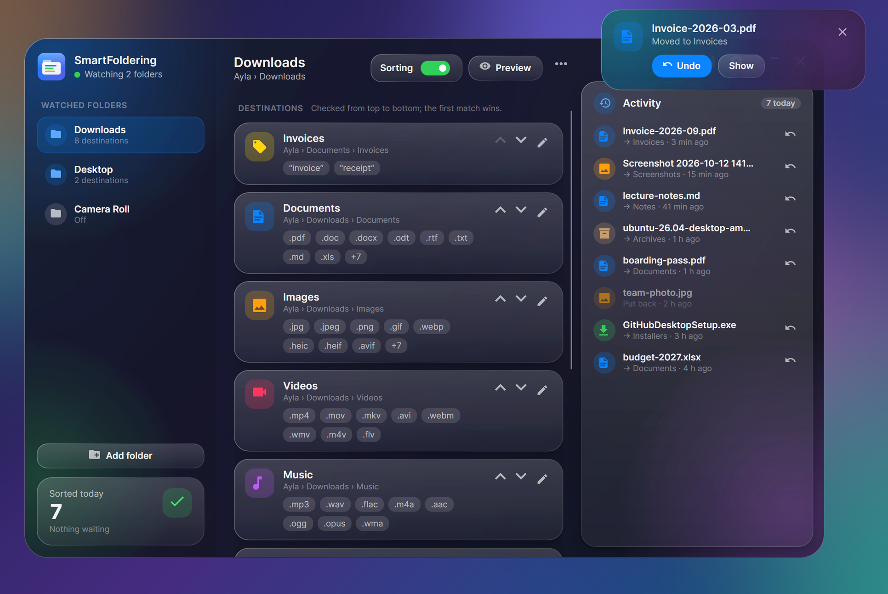
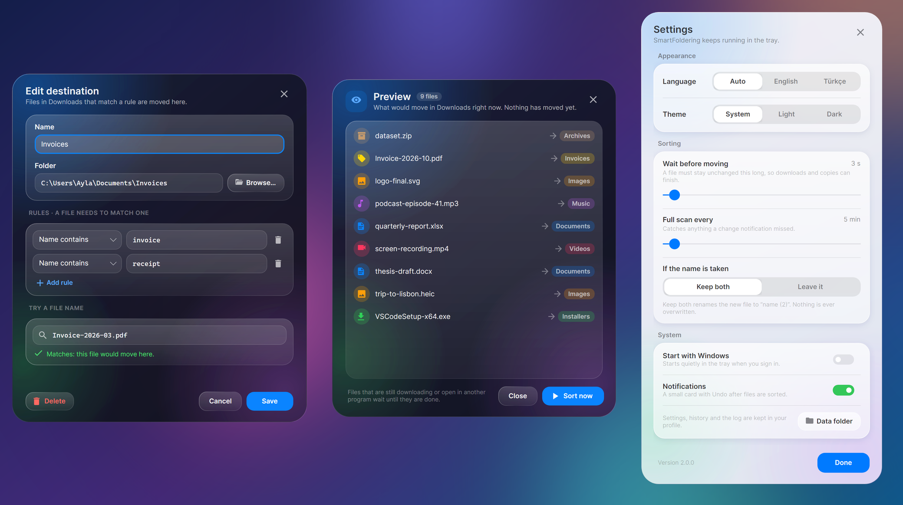
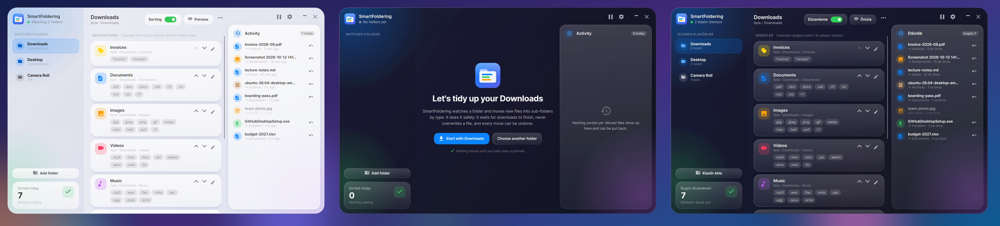

# SmartFoldering

[](https://github.com/furkiak/SmartFoldering/actions/workflows/ci.yml)
[](https://github.com/furkiak/SmartFoldering/releases/latest)


<p align="center">
  
</p>

**SmartFoldering** keeps your Downloads folder (or any other folder) tidy. It watches the folder from the system tray and moves each new file into the right sub-folder: PDFs to *Documents*, photos to *Images*, installers to *Installers* and, with a rule you add in a few seconds, anything with "invoice" in its name to *Invoices*.

It is careful about it. It waits until a download has really finished, never overwrites a file, shows you what would move before it moves anything, and every move can be undone.

*Türkçe açıklama için [aşağıya](#türkçe) bakın.*

---

## Download

Get the latest `SmartFoldering-<version>-win-x64.exe` from the [releases page](https://github.com/furkiak/SmartFoldering/releases/latest). It is a single file that needs nothing installed. The smaller `-framework-dependent.exe` needs the [.NET 10 Desktop Runtime](https://dotnet.microsoft.com/download/dotnet/10.0).

Windows SmartScreen may warn on the first launch because the app is not code-signed: choose *More info → Run anyway*. Each release lists SHA-256 checksums.

Coming from **version 1**? Quit it first. Your folders and rules are picked up automatically, and sorting starts paused so you can look before anything moves.

## How it works

1. **Add a folder.** *Start with Downloads* adds your Downloads folder with seven ready-made destinations (documents, images, videos, music, archives, installers, code). You can also pick any folder, with or without those rules.
2. **Look at the preview.** A new folder starts switched off. The preview lists exactly which files would move where. Nothing moves until you press *Turn on sorting*.
3. **Let it run.** New files are sorted a few seconds after they settle. The activity list shows every move with a *Put back* button, and a small notification offers *Undo* when the window is closed.

## Features

**Rules**
- **Destinations with rules**: extension (`pdf, docx, xlsx`, also double extensions like `tar.gz`), name contains (`invoice`), or a regular expression (`^IMG_\d{4}`). A file needs to match one rule.
- **Order matters, and you can see it**: destinations are checked from top to bottom and the first match wins. Move them up and down on their cards.
- **Try a file name**: the editor tells you whether a name like `Invoice-2026-03.pdf` would land in this destination, or whether an earlier one takes it first.
- **Ready-made rules** for typical downloads, with folder names in your language (*Belgeler*, *Görseller*… in Turkish).

**Safe moves**
- **Waits for downloads to finish**: browser partial files (`.crdownload`, `.part`, `.download`…) and their empty placeholders are never moved; a file must stay unchanged for a few seconds and must not be open in another program.
- **Never overwrites**: a taken name becomes `report (2).pdf`, or the file is left where it is, your choice.
- **Undo** from the activity list or the notification. A file you put back is left alone for a day instead of being sorted straight back.
- **Nothing is missed**: change notifications are backed by a full scan every few minutes, and a notification overflow triggers an immediate scan.
- **Office lock files, hidden and system files are ignored.** A destination that points at the watched folder itself is ignored instead of renaming files in a loop.

**Everyday use**
- Lives in the **tray**: pause, scan now, settings and quit from its menu. Closing the window keeps sorting.
- **Start with Windows**, quietly in the tray. The entry follows the app if you move it.
- **Notifications** that batch several files into one card and never steal keyboard focus.
- **Liquid Glass design** in **light and dark**, following the system or your choice.
- **English and Turkish**, switchable at runtime.
- **Single instance**: launching it again brings the running app forward.

<p align="center">
  
</p>
<p align="center">
  
</p>

## Settings

| Setting | Default | What it does |
|---|---|---|
| Wait before moving | 3 s | How long a file must stay unchanged before it is moved (1–60 s). |
| Full scan every | 5 min | Safety net for missed change notifications (1–120 min). |
| If the name is taken | Keep both | *Keep both* renames the new file to `name (2)`; *Leave it* does not move it. |
| Notifications | On | A card with Undo after files are sorted (only while the window is not in front). |
| Start with Windows | Off | Adds a per-user Run entry that starts the app in the tray. |

Settings, the move history and a small log are kept in `%APPDATA%\SmartFoldering` (the *Data folder* button opens it).

## Building

Requires the [.NET 10 SDK](https://dotnet.microsoft.com/download/dotnet/10.0).

```bash
dotnet run --project src/SmartFoldering
```

```bash
dotnet test tests/SmartFoldering.Tests
```

```bash
dotnet run --project tools/Screenshots -- shots --selftest
```

The last command renders every window headlessly and drives the view models against real folders (add a folder, preview, edit a rule, sort, undo, pause, switch language). CI runs all three on every push. `python tools/make_readme_images.py` composes the README images from `--scale 2 --matte` renders, and `tools/make_icon.ps1` draws the icon.

**Project layout**

| Folder | Contents |
|---|---|
| `src/SmartFoldering.Core` | The engine: rules, safety checks, moves, history, settings and the 1.x migration. No UI code. |
| `src/SmartFoldering` | The Avalonia app: windows, view models, tray, notifications, EN/TR strings. |
| `tests/SmartFoldering.Tests` | xUnit tests against real temporary folders, including a live `FileSystemWatcher`. |
| `tools/Screenshots` | Headless renderer and UI self-test. |

Releases are built by GitHub Actions when a `v*` tag is pushed (see `.github/workflows/release.yml`).

---

## Türkçe

**SmartFoldering**, İndirilenler klasörünü (ya da istediğin herhangi bir klasörü) düzenli tutar. Sistem tepsisinden klasörü izler ve her yeni dosyayı doğru alt klasöre taşır: PDF'ler *Belgeler*'e, fotoğraflar *Görseller*'e, kurulum dosyaları *Kurulumlar*'a; birkaç saniyede ekleyeceğin bir kuralla da adında "fatura" geçen her şey *Faturalar*'a.

Bunu dikkatle yapar. Bir indirmenin gerçekten bitmesini bekler, hiçbir dosyanın üzerine yazmaz, bir şey taşımadan önce neyin taşınacağını gösterir ve her taşıma geri alınabilir.

### İndirme

Son `SmartFoldering-<sürüm>-win-x64.exe` dosyasını [sürümler sayfasından](https://github.com/furkiak/SmartFoldering/releases/latest) indir. Tek dosyadır, kurulum gerektirmez. Daha küçük olan `-framework-dependent.exe` için [.NET 10 Desktop Runtime](https://dotnet.microsoft.com/download/dotnet/10.0) gerekir.

Uygulama kod imzalı olmadığı için Windows SmartScreen ilk açılışta uyarabilir: *Ek bilgi → Yine de çalıştır*'ı seç. Her sürümde SHA-256 özetleri bulunur.

**1. sürümden** mi geliyorsun? Önce onu kapat. Klasörlerin ve kuralların otomatik olarak aktarılır; bir şey taşınmadan önce bakabilmen için düzenleme duraklatılmış olarak başlar.

### Nasıl çalışır?

1. **Bir klasör ekle.** *İndirilenler ile başla*, İndirilenler klasörünü yedi hazır hedefle (belgeler, görseller, videolar, müzik, arşivler, kurulumlar, kod) ekler. İstersen başka bir klasörü bu kurallarla ya da kuralsız da seçebilirsin.
2. **Önizlemeye bak.** Yeni bir klasör kapalı başlar. Önizleme hangi dosyanın nereye taşınacağını tek tek listeler. *Düzenlemeyi aç*'a basana kadar hiçbir şey taşınmaz.
3. **Bırak çalışsın.** Yeni dosyalar durulduktan birkaç saniye sonra düzenlenir. Etkinlik listesi her taşımayı *Geri al* düğmesiyle gösterir; pencere kapalıyken küçük bir bildirim *Geri al* seçeneği sunar.

### Özellikler

**Kurallar**
- **Kurallı hedefler**: uzantı (`pdf, docx, xlsx`, `tar.gz` gibi çift uzantılar da), adında geçen (`fatura`) ya da düzenli ifade (`^IMG_\d{4}`). Dosyanın bir kurala uyması yeterli.
- **Sıra önemli ve görünür**: hedeflere yukarıdan aşağıya bakılır, ilk eşleşen kazanır. Kartlardaki oklarla sırayı değiştir.
- **Bir dosya adı dene**: düzenleyici, `Fatura-2026-03.pdf` gibi bir adın bu hedefe mi gideceğini, yoksa önce gelen başka bir hedefin mi alacağını söyler.
- **Hazır kurallar**, klasör adları senin dilinde (*Belgeler*, *Görseller*…).

**Güvenli taşıma**
- **İndirmelerin bitmesini bekler**: tarayıcıların yarım dosyaları (`.crdownload`, `.part`, `.download`…) ve boş yer tutucuları asla taşınmaz; dosya birkaç saniye değişmeden kalmalı ve başka bir programda açık olmamalıdır.
- **Üzerine yazmaz**: ad doluysa yeni dosya `rapor (2).pdf` olur ya da yerinde bırakılır; seçim senin.
- **Geri al**: etkinlik listesinden ya da bildirimden. Geri konan dosya, hemen yeniden taşınmak yerine bir gün rahat bırakılır.
- **Hiçbir şey kaçmaz**: değişiklik bildirimlerinin arkasında birkaç dakikada bir tam tarama vardır; bildirim taşması anında tarama başlatır.
- **Office kilit dosyaları, gizli ve sistem dosyaları yok sayılır.** İzlenen klasörün kendisini gösteren bir hedef, dosyaları sonsuz döngüde yeniden adlandırmak yerine yok sayılır.

**Günlük kullanım**
- **Tepside** yaşar: menüsünden duraklat, şimdi tara, ayarlar ve çık. Pencereyi kapatmak düzenlemeyi durdurmaz.
- **Windows ile başlat**, sessizce tepside. Uygulamayı taşırsan kayıt da onu izler.
- Birden çok dosyayı tek kartta toplayan ve klavye odağını asla çalmayan **bildirimler**.
- Sistemi ya da senin seçimini izleyen **açık ve koyu** **Liquid Glass tasarım**.
- Çalışırken değiştirilebilen **Türkçe ve İngilizce**.
- **Tek kopya**: yeniden açmak, çalışan uygulamayı öne getirir.

### Ayarlar

| Ayar | Varsayılan | Ne yapar |
|---|---|---|
| Taşımadan önce bekle | 3 sn | Dosya taşınmadan önce ne kadar süre değişmeden kalmalı (1–60 sn). |
| Tam tarama sıklığı | 5 dk | Kaçırılan değişiklik bildirimleri için güvenlik ağı (1–120 dk). |
| Ad zaten varsa | İkisini de tut | *İkisini de tut* yeni dosyayı `ad (2)` yapar; *Yerinde bırak* onu taşımaz. |
| Bildirimler | Açık | Dosyalar düzenlenince Geri al düğmeli bir kart (pencere öndeyken gösterilmez). |
| Windows ile başlat | Kapalı | Uygulamayı tepside başlatan kullanıcıya özel bir Run kaydı ekler. |

Ayarlar, taşıma geçmişi ve küçük bir günlük `%APPDATA%\SmartFoldering` içinde tutulur (*Veri klasörü* düğmesi orayı açar).

### Derleme

[.NET 10 SDK](https://dotnet.microsoft.com/download/dotnet/10.0) gerekir. `dotnet run --project src/SmartFoldering` uygulamayı açar, `dotnet test tests/SmartFoldering.Tests` motor testlerini çalıştırır, `dotnet run --project tools/Screenshots -- shots --selftest` bütün pencereleri ekransız çizer ve görünüm modellerini gerçek klasörler üzerinde dener. CI her push'ta üçünü de çalıştırır; `v*` etiketi gönderildiğinde GitHub Actions sürümü derleyip yayımlar.

---

**License / Lisans:** [MIT](LICENSE)
