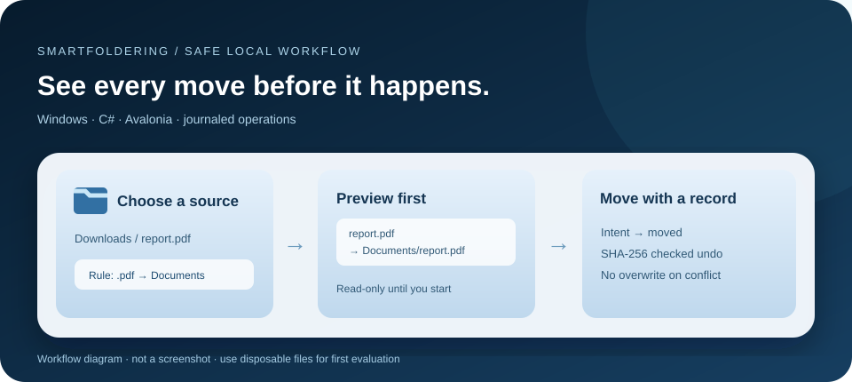

# SmartFoldering

**Preview and organize local files with explicit control.** SmartFoldering is a C#/.NET 9 Avalonia desktop app. It matches top-level files in selected source folders against extension or filename-keyword rules, then moves them to destination folders. This revision adds a read-only preview, a single processing queue, a persistent move journal, and a guarded one-step undo.



> Preview source revision: Windows Release build and synthetic-file tests pass. The revised native interface, tray and clean-machine package have not yet been exercised. The diagram is a workflow explanation, not a product screenshot.

## Quick start on Windows

Install the .NET 9 SDK and run from the repository root:

```powershell
dotnet run --project SmartFoldering.csproj
```

1. Add a source folder, such as a **test** `Downloads` folder. Add a destination folder and an extension rule such as `.pdf`.
2. Choose **Preview moves**. The proposed source and destination paths are displayed without moving a file.
3. Review the list, then choose **Start monitoring**. If rules change, monitoring pauses and another preview is required.
4. Choose **Pause monitoring** before **Undo last move**. Undo refuses to overwrite an existing source or move a destination whose SHA-256 differs from the recorded file.

For source development: `dotnet test SmartFoldering.Tests/SmartFoldering.Tests.csproj -c Release`. There is no published installer for this revision. Start with disposable test files until the native Windows acceptance check is complete.

## Example preview

With `C:\Test\Downloads\report.pdf` and rule `.pdf → C:\Test\Documents`:

```text
Preview: 1 proposed move
report.pdf → C:\Test\Documents\report.pdf
```

If `report.pdf` already exists at the destination, the plan proposes `report (1).pdf`. At execution, a new conflict or changed source causes a **skip and error**, not an overwrite. A watcher event and five-minute fallback scan enter the same single-reader queue. The scan does not recurse into subfolders. The app waits for exclusive access and stable file metadata before moving, but no watcher can guarantee the exact instant an external process has finished writing.

## Safety boundaries

- A destination cannot equal, contain, sit inside, or feed a watched source. Overlapping watched sources are rejected; these checks also prevent A→B→A cycles.
- Linked/junction paths and linked files are rejected. Automatic source and destination must be on the same volume. Temporary download suffixes such as `.part` and `.crdownload` are skipped.
- Each move writes an intent to `%APPDATA%\SmartFoldering\operations.jsonl`, then moves the file and writes a completion event. SHA-256 identifies the moved bytes for undo. A crash between move and completion leaves an intent that can be reconciled by the undo path if the destination still matches.
- Rule settings use unique temporary files, disk flush and an atomic replacement with `settings.json.bak`. A failed save reports an error and the running engine keeps the last committed rules. Editing rules pauses monitoring before the new settings are saved.
- Windows auto-start is a separate setting; it should be enabled only after the workflow has been checked on the user's machine.

Operation history can expose file names and paths. It is local to the OS user profile and is not uploaded by the source app. There is no automatic retention or secure erasure. Back up important data independently; a journal and one-step undo do not replace a backup. See [recovery and limits](docs/SAFETY.md).

## Scope and verification

The code uses cross-platform APIs in several places, but macOS and Linux builds, packaging, permissions, watcher behavior and UX have **not** been verified. Windows is the intended first release target. The source currently targets .NET 9; moving to a later runtime is a separate compatibility task. See [support gates](docs/SUPPORT.md), [changelog](CHANGELOG.md), [contributing](CONTRIBUTING.md) and [security reporting](SECURITY.md). Licensed under [MIT](LICENSE).

## Türkçe

SmartFoldering, kurallara göre yerel dosyaları taşımadan önce **önizleme** gösteren C# / Avalonia uygulamasıdır. Yeni sürümde izleme varsayılan olarak kapalıdır. Kaynak, hedef ve kuralı ekledikten sonra **Preview moves** ile yolları incele; **Start monitoring** ile başlat. Kurallar değişince izleme durur. **Undo last move** yalnızca izleme duraklatıldığında, kaynak yol boşsa ve hedef dosya taşınan dosyayla aynı SHA-256 değerindeyse çalışır. Başlangıç için gerçek belgelerin yerine geçici test dosyaları kullan. Windows arayüz ve temiz makine testi bitmeden bu kaynak paketi herkese açık kararlı sürüm olarak sunulmuyor.
