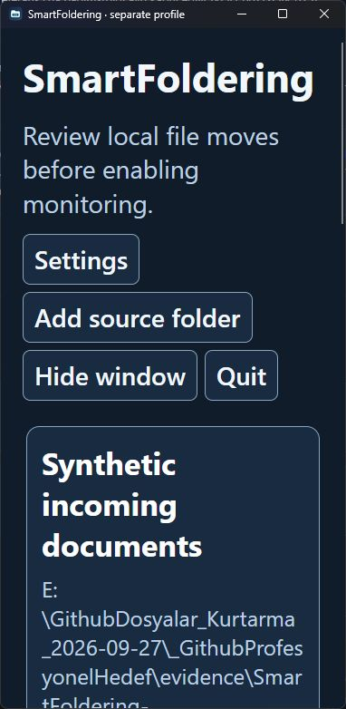
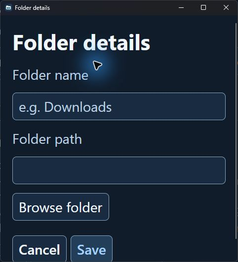
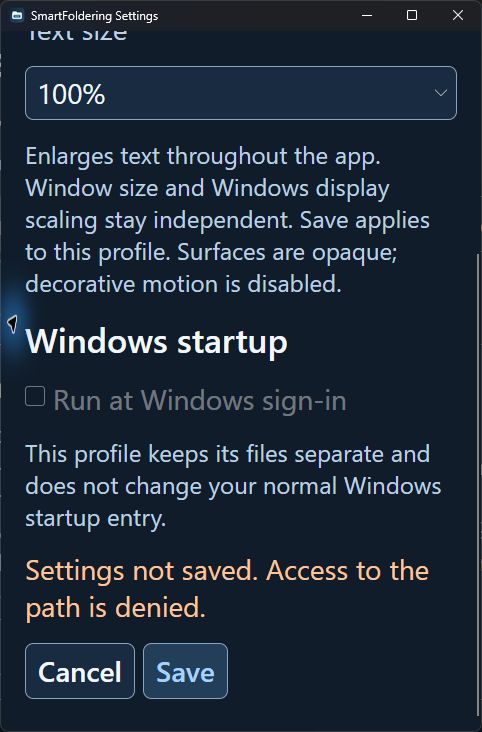

# Appearance and accessibility candidate

Local version **0.3.0-preview.1** adds **Settings → Theme (Light / Dark)** and **Text size (100% / 150% / 200%)**. Save applies immediately to open windows and persists only in the selected profile. Legacy settings without either field keep their former Dark theme and 100% text. This is font-size scaling: body text is 14 / 21 / 28 logical units, captions 12 / 18 / 24, and headings grow by the same multiplier. It does not change Windows DPI or scale a screenshot, render transform or whole window.

Windows use opaque window/card/soft surfaces. There is no native blur, Acrylic, Mica or glass compositor path. Decorative transitions and pressed-button transforms are disabled. Caret blinking, scroll interactions and the existing four-second notification lifetime are not decorative animation and retain their previous behavior. Persistent command errors remain in the main window or Settings feedback; a transient notification is not the only proof of an unsuccessful appearance save.

The main four actions and source/destination/rule actions wrap to additional rows. Text and paths wrap; content has natural height within an outer automatic vertical scroll viewer. Settings, folder/filter dialogs and lists can resize and scroll. Their standard window frame provides native move/resize controls; closing the main window still hides it in the tray, while **Quit** stops the worker. Closing a destination/filter window returns to its parent.

## Source contrast calculation

The following minima use WCAG sRGB relative luminance on **opaque source token pairs**, across window, card, soft and hover surfaces. Normal text includes primary, secondary, accent, warning and fully opaque textbox watermark colors. Disabled controls and the OS-owned window frame are outside this calculation.

| Theme | Normal text minimum | Control boundary minimum | Keyboard focus minimum |
| --- | ---: | ---: | ---: |
| Light | 5.1594:1 | 3.2574:1 | 6.5112:1 |
| Dark | 5.6658:1 | 3.4969:1 | 6.7298:1 |

The application supplies a two-unit keyboard focus outline and explicit textbox/combobox focus borders. Textbox watermark opacity is 1; radio/checkbox boundaries and active glyphs use the same palette. Template-part selectors follow the pinned Avalonia 11.2.7 [TextBox](https://github.com/AvaloniaUI/Avalonia/blob/11.2.7/src/Avalonia.Themes.Fluent/Controls/TextBox.xaml), [ComboBox](https://github.com/AvaloniaUI/Avalonia/blob/11.2.7/src/Avalonia.Themes.Fluent/Controls/ComboBox.xaml), [CheckBox](https://github.com/AvaloniaUI/Avalonia/blob/11.2.7/src/Avalonia.Themes.Fluent/Controls/CheckBox.xaml) and [RadioButton](https://github.com/AvaloniaUI/Avalonia/blob/11.2.7/src/Avalonia.Themes.Fluent/Controls/RadioButton.xaml) templates. These calculations are not rendered measurements, a screen-reader audit, or a native acceptance result.

## Persistence and safety

- `SaveAppearanceAsync` uses the same serialized writer, unique temporary file, disk flush and atomic main/backup replacement as operational settings. It saves a copy of committed rules and monitoring state; pending rule edits remain pending in the current UI objects. Appearance changes do not increment the preview revision, fire `RulesChanging`, stop monitoring or commit a rule edit.
- Existing operational saves retain their revision and pause-on-rule-change behavior. Windows sign-in startup is written only when its checkbox actually changes. Separate profiles cannot write that registry entry. If appearance succeeds but a requested registry change fails, Settings says so explicitly; the two storage systems are not an atomic transaction.
- Unsupported or duplicate appearance fields are rejected without automatically replacing the current file with an older backup. Both original files are checked before a save, and incompatible external main/backup edits block replacement. Existing malformed-JSON backup recovery remains available during startup. Unknown **top-level** JSON fields are preserved; this is not a promise to understand every future nested schema. Restore an incompatible/damaged backup explicitly after preserving a copy; do not delete personal data to make Save succeed.
- The local suite has **40 passing tests, zero skipped**, including the previous 22 cases and three actual Windows integration tests. New behavior checks cover legacy upgrade/restart/byte-exact backup, unknown top-level data, pending UI objects, failed writes, unsupported preferences and concurrent saves. A production watcher remains active after two appearance saves and moves a later real file. Mutations that accept invalid preferences or alter the preview revision fail the relevant tests; the restored source passes again. See [Windows integration](WINDOWS_INTEGRATION.md) for real overflow/ACL/ReadOnly scope.

## Reproducible native checks

Use the new package with an **absolute disposable** `--data-directory`, never the normal profile. Preserve earlier packages and any fixture baseline.

1. Create an owned source and separate target with one `.pdf` rule; place a test PDF and a nonmatching file in the source. Choose Preview, inspect both paths, then open Settings, save **Light / 200%** and reopen it. Confirm both preferences and the source/target rules survive. The preview should remain approved, and Start should start rather than demand another preview solely because appearance changed.
2. At the main window's minimum width, use Tab/Shift+Tab and Enter/Space. Confirm the four actions wrap, all focused controls have a visible outline, and scrolling reaches Preview/history. Open folder, destination and filter windows, test long path/value text and dropdowns, and return with Back or the native close button. Repeat in Dark at 200%.
3. While monitoring runs, change to Dark / 150%, create a second test PDF and confirm one correct move. Pause before Undo; check the original source bytes and journal. Rule edits must still pause monitoring and require another reviewed preview.
4. Save Light / 100%, Quit, relaunch the same disposable profile and verify the persisted choice. If monitoring was left enabled, the existing resume-to-tray behavior applies; pause before exit when a visible startup is needed. Check normal profile JSON and startup registry baselines remain unchanged.
5. In an owned ReadOnly-settings fixture, try appearance Save; confirm persistent feedback, unchanged main/backup hashes and unchanged rendered preference. Exit and restore the original attribute before cleanup. This native UI failure case is separate from the automated real-permission tests.

## Native Windows observations, 27 September 2026

The candidate was exercised on Windows 11 with an absolute disposable profile and owned synthetic source/target folders. Legacy settings opened Dark/100%. A read-only Preview proposed exactly one PDF move. Saving Light/200% preserved that approval: Start monitoring succeeded without another Preview and moved the file byte-exact. Saving Dark/200% and then Dark/150% while monitoring left the watcher active; a later PDF moved exactly once. Pause and native Undo restored that second file with its original SHA-256 and one `undone` journal record. A nonmatching text file remained unchanged, and an unknown top-level setting survived every successful save.

Main at 380px and Settings/folder/destination/filter windows at 360px were inspected with 200% fonts. Actions wrap, long paths and names wrap, and keyboard focus scrolls bottom actions into view. The main title originally split across lines at 200%; the revised 22/33/44-unit heading keeps the full name at minimum width. Theme/font dropdown values and native focus outlines were readable. Folder and filter forms were cancelled; persisted rules and backup digests stayed unchanged.

Native inspection also found that the Fluent textbox watermark remained half opaque despite a style opacity setter. The pinned template sets `Opacity="0.5"` locally. `AccessibleTextBox` retains the normal TextBox style/behavior and sets the applied watermark's opacity to 1; the corrected empty native folder form was then inspected at Dark/200%. Source palette calculations above describe this corrected opacity, not the earlier translucent placeholder.

An owned ReadOnly `settings.json` caused native Save to fail with persistent, readable feedback. The main and backup digests and Dark/200% preferences stayed unchanged; pending Light/100% did not apply. After the original attribute was restored, retry succeeded, saved Light/100%, and preserved the previous main bytes as the backup. Saving disables/re-enables Save. The failure path updates the enlarged error layout before restoring keyboard focus and bringing Save into view: native Dark/200% at 360px changed the scroll offset from 322 to 452, exposing the entire error and both retry/cancel buttons. The earlier focus-only revision left Save below the viewport and was superseded. Dark/150% persistence was verified after exit/relaunch. Sampled normal settings/backups and Windows Run-entry digests matched the before/after checkpoint.

No remote publication, normal startup change, OS display/theme preference change or personal-profile migration was performed. Full cross-theme interaction coverage, screen-reader output, alternate DPI, physical tray reopening, another OS user and clean-machine installation remain open. Source ratios and screenshots do not certify WCAG conformance. Earlier native screenshots remain historical evidence for their dated layout.

## Türkçe

**Settings → Theme / Text size** ile açık/koyu tema ve gerçek %100/%150/%200 yazı boyutu seçilir; Save yalnız seçili profilin JSON dosyasını atomik kaydeder. Eski ayarlar Dark/%100 açılır. Görünüm kaydı preview onayını bozmaz, kuralları kaydetmez ve çalışan izlemeyi durdurmaz. Kontroller sarılır, içerik kaydırılır; yüzeyler opaktır, native blur yoktur. Kaynak renk kontrastları ve 40 davranış testi doğrulandı. Ayrı Windows profilinde %200 dar pencere/klavye, görünüm kaydında preview ve izleme korunması, dosya hashleri, geri alma ve ReadOnly hata/tekrar deneme kontrol edildi. Farklı DPI, ekran okuyucu ve tam tema matrisi açıktır. Eski ekran görüntüleri önceki yerleşime aittir. Normal startup kaydı sadece checkbox gerçekten değişirse yazılır; ayrı profil bunu değiştiremez.
