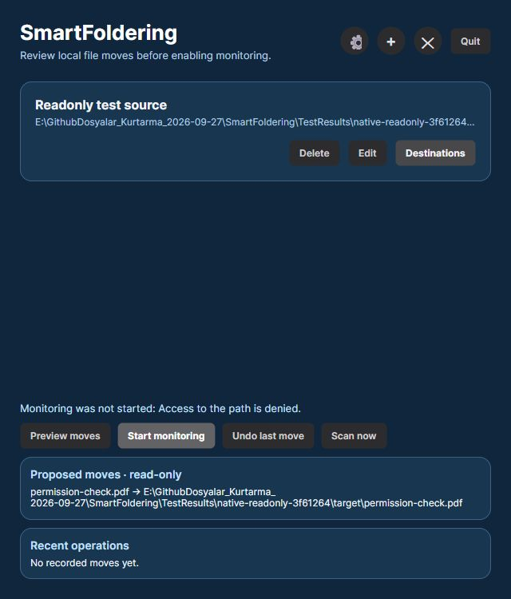

# Windows watcher and permission integration

The suite has 37 ordinary behavior tests and three opt-in Windows integration tests, including the appearance-persistence candidate. Choose an absolute disposable workspace folder explicitly; do not select your normal profile, Downloads or an existing folder of personal files.

```powershell
$env:SMARTFOLDERING_WINDOWS_TEST_ROOT = Join-Path (Get-Location) 'TestResults\windows-fixtures'
dotnet test SmartFoldering.Tests/SmartFoldering.Tests.csproj -c Release --logger 'trx;LogFileName=windows-integration.trx' --results-directory TestResults
```

Without the variable, or outside Windows, the three integration tests are skipped rather than reported as verified. The local appearance-candidate run passed all 40 with no skips; the earlier 22-case record is retained. Each integration case creates a unique child with an ownership marker under the chosen root. ACL changes affect only that child's settings directory. The test restores its original access rules and inheritance protection in `finally`, verifies ownership did not change, then proves saving works again. Cleanup refuses a path outside the owned fixture. No normal user directory, registry value or personal settings file is changed.

## Real kernel overflow

The test uses the application's actual `FileSystemWatcher` and its production **65,536-byte** buffer. Reflection is used only to inspect the watcher and briefly hold the existing queue gate; it does not raise an event or inject an exception. The initial full scan waits on a real exclusively locked file. While a native callback is delayed, 1,200 temporary create/delete pairs and three sentinel files generate a notification burst. Windows must raise `InternalBufferOverflowException`; the test fails if it does not. At least one sentinel must lack any individual created/changed/renamed notification.

After the locked file is released, the overflow-triggered full scan must recover every sentinel with unchanged SHA-256 and exactly one completed journal entry per file. Neither `ForceScanNow` nor the five-minute fallback is used. The old implementation produced a real overflow and lost all three sentinel notifications, but suppressed the requested rescan while the initial scan's key was pending. Queue requests now remain coalesced while waiting and become eligible for one later request as processing begins, so a scan requested after the current file-list snapshot is retained.

This is a controlled local NTFS/Windows test. It does not establish behavior for another filesystem, network share or every possible event storm.

## Real permission failures

- The ACL case adds a current-user **deny CreateFiles** entry to the owned settings directory. An independent file-creation probe and the real `SaveSettingsAsync` path must return Windows access denied (`0x80070005`). The original main JSON, backup JSON, revision and both current/committed settings remain unchanged; no temporary file remains. Original access rules and owner are checked after restoration, followed by a successful save. Windows can normalize the DACL's auto-inherited control flag, so verification compares every access entry and inheritance protection rather than requiring identical descriptor text.
- The read-only case sets the existing owned `settings.json` file's Windows ReadOnly attribute. Atomic replacement must fail, preserve the same committed state and bytes, and remove its temporary file. The original attributes are restored in `finally`; the next save must succeed.

The settings service returns these failures by exception. Main-window commands show `Folder not saved` or `Monitoring was not started`, while destination/rule dialogs show their explicit save failure. On 27 September 2026 the actual Windows UI was also exercised in a disposable ReadOnly-settings profile: Preview reported one move; Start displayed `Monitoring was not started: Access to the path is denied.` and remained Start. Settings/source SHA256 stayed unchanged, the target stayed empty and no journal was created. Quit ended the process, then the original attributes were restored. See the actual native screenshot below. To repeat the native check, use a separate profile with a readable but read-only `settings.json`, run Preview and then Start, and confirm monitoring stays off and an error appears. Exit, restore the original file attributes and retry. The Windows sign-in registry setting uses a separate save path and is not exercised by the filesystem tests.



